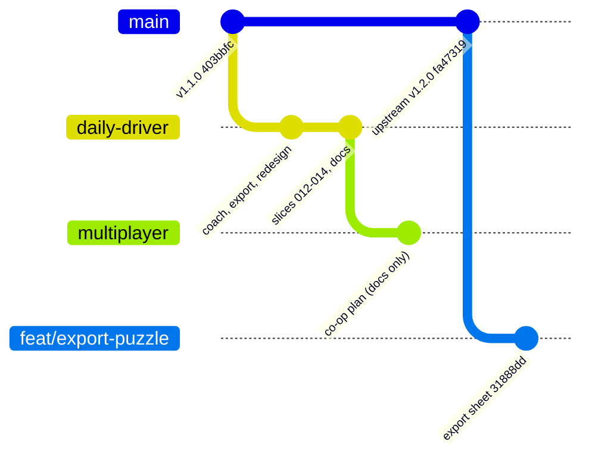

# Upstream contribution

Read this before touching git remotes, branches or PRs. Rules are also summarised in
`AGENTS.md`. Last updated: 2026-11-05.

Upstream is `likhithpraveenk/sudoku`, a hobby app with real users (F-Droid, GitHub
releases, Obtainium). Anything we send costs its author time and attention, and he never
asked for it. We are guests there.

## History: PR #11

On 2026-10-11 a PR "Coach and export" was opened by accident from `Jacl3r:coach-and-export` (since renamed `daily-driver`)
to upstream `main` (the empty template, closed after ~15 seconds). The author answered
anyway, and the thread is the best statement we have of what he wants:

- <https://github.com/likhithpraveenk/sudoku/pull/11>
- He read the work as "interesting".
- He **already built a proper hint system** (next solvable cell plus technique) and
  dropped it: *"too complex and UI wasn't clean"*. So a coach is a hard sell, not a
  given.
- **Export** to paste into an AI is *"a simple addition"*. Welcome, if kept simple.
- A **custom puzzle builder** *"shouldn't be too difficult"*. Not built here.
- He was then working on configurable vertical grid placement (landed in v1.2.0),
  per-number accessibility colours, and possibly sizes for big and pencil digits.
  Anything touching settings, grid layout or cell rendering will collide with that.
- Design reference is Clean Sudoku by Dustland Designs: calm, minimal.

The owner replied there that the push was accidental and that the work is personal.
Treat that as context: any later contact is a deliberate, polite follow-up, not a
surprise second PR. Do not behave as if the first message never happened.

## How the author works (copy this)

- Branch names `feat/…`, `fix/…`, `refactor/…`; one small PR per change, 1-3 commits.
- Conventional commit subjects, lowercase: `feat: wakelock on game screen`.
- PR template (`.github/PULL_REQUEST_TEMPLATE.md`): description, `Closes #n`, type of
  change, and the three checks `dart format .` (0 changed), `dart fix --apply` (nothing
  to fix), `flutter analyze` (no issues). UI changes need before/after screenshots.
- AI help is accepted (see the README's AI Policy) provided the human reviewed every
  change. Say plainly in the PR that it was written with an AI assistant and reviewed.
- He is also working on `main` himself. Expect it to move; rebase before opening.
- Upstream has Discussions enabled. That is the right place to ask "would you want
  this?" before any code.

## Rules

1. **Consent every time.** Opening a PR, Discussion or issue, or commenting in upstream,
   needs the owner's explicit yes in the current conversation. Before asking, state the
   consequences: it notifies the author, creates a public record under the owner's
   name, and asks for review time. A past yes does not carry over.
2. **Pushing to `origin` is not contact.** `origin` is the fork. But a fresh push to a
   fork makes GitHub show a "Compare & pull request" banner that targets upstream by
   default. That banner is how PR #11 happened. Do not click it unless we mean it.
3. **Cut from `upstream/main`, not from `daily-driver`.** Fetch first
   (`git fetch upstream`). Cherry-pick or re-implement the minimum; do not merge the
   fork branch.
4. **Never include fork-only changes**: applicationId, "Sudoku+" label,
   `fork-android.yml`, edits to `release.yml` / `deploy-web.yml` (the fork disables
   them), `AGENTS.md`, `docs/`, version bumps.
5. **One concern per branch.** No refactors riding along. Do not touch settings, grid
   sizing or cell colours without checking what upstream `main` has just done there.
6. **Match his bar before opening**: the three template checks, `flutter test` green,
   screenshots for UI, a short honest description, and tests beside the layer.
7. **Never `v*` tags, never push to upstream** (we have no write access, and a tag in
   the fork publishes a signed release via `fork-android.yml`).
8. **Be easy to refuse.** A PR or Discussion says what, why, and that closing it
   unmerged is fine. If he says no or goes quiet, drop it; do not re-ping.

## Commit and PR messages

- Commit messages: plain conventional subjects, matching his style. They may describe
  the change but should not contain the linkable form `likhithpraveenk/sudoku#11` or
  `#11`: GitHub turns that into a cross-reference on his PR and notifies him, which
  would be contact by the back door.
- The reference to PR #11 belongs in a deliberate PR or Discussion body, in prose, for
  example "follows up on the idea I mentioned in #11", and only after consent per
  rule 1. Be honest there: it is a follow-up to an accidental PR, and the work was
  developed with an AI assistant.
- Branch pushes to the fork that carry no upstream reference are fine without consent.

## Branch layout (one fork)

GitHub allows one fork of a repo per account, so separation is by branch:

| Kind | Branch | Based on | Purpose |
|---|---|---|---|
| Mirror | `main` | `upstream/main` | Fast-forward only. No work, no commits. |
| Personal | `daily-driver` | `v1.1.0` | Daily driver: fork id, label, fork CI. |
| Personal | `multiplayer` | `daily-driver` | Private experiment, never merged. |
| Upstream-bound | `feat/...`, `fix/...` | `upstream/main` | One concern each, his naming. |

Notes:

- Upstream's `deploy-web.yml` runs on every push to `main`. In the fork it fails or
  does nothing useful; ignore the red X after a mirror sync.
- Never push upstream's tags to `origin`: the upstream `release.yml` and our
  `fork-android.yml` both react to `v*`.
- Upstream-bound branches do not carry `fork-android.yml`, so the fork runs no CI on
  them. Run `dart format .`, `dart fix --apply`, `flutter analyze` and `flutter test`
  locally before pushing.
- When upstream merges a piece, drop our copy from `daily-driver` instead of
  carrying a duplicate.
- Catching `daily-driver` up to upstream (11 conflicting files) is a separate
  task, done after the small pieces are settled.

### `fork-android.yml`: do we need it?

It came from the first AI-assisted commit (`07f5fc0`). It does two things:

- **Analyze and test on every push.** Used: 11 runs, all green. Keep it.
- **Signed APK and GitHub release on a `v*` tag** (for Obtainium updates). Never run:
  no tag exists, and it needs four keystore secrets that may not be set. It is the
  only part that can publish something, so it stays a risk. Until a signed daily
  driver is wanted, the local `flutter build apk` path in `docs/handoff.md` is enough;
  removing the `apk` job is an option, not a necessity.

## Planned split

Order matters; each step needs its own consent.

| # | Piece | Branch (off `upstream/main`) | Notes |
|---|---|---|---|
| 0 | Ask first | none (a Discussion) | Short note and screenshots, no code in it. Draft: `docs/upstream-draft-discussion.md`. Say no is fine. |
| 1 | Export sheet | `feat/export-puzzle` (`31888dd`) | Built and pushed to the fork. Copy-only, three contents, three formats, optional AI prompt. The action sits in the game top bar next to the theme picker, because it applies to the whole board. No share channel, no link format, no remembered choice. |
| 2 | Turbot Fish fix | none | **Retracted, see below.** Branch deleted. |
| 3 | Coach | only if he says yes | He dropped a hint system as too complex. A lighter, opt-in version at most. |
| 4 | Later, small, unevaluated | `feat/...` | Keyboard shortcuts (his `Focus` handler only knows arrows, digits and `p`); persisted undo (touches his own `GameAction` refactor, so ask first). |
| – | Not for upstream | never | Home/settings redesign, resume card, import library, first-run theme sheet, same-digit highlight change, fork CI and ids. |

### Map

| Branch | Based on | Role | Goes upstream? |
|---|---|---|---|
| `main` | `upstream/main` | Mirror, fast-forward only | n/a |
| `daily-driver` | `v1.1.0` | Personal daily driver | Never as a whole |
| `multiplayer` | `daily-driver` | Private experiment | Never |
| `feat/export-puzzle` | `upstream/main` | Candidate PR piece 1 | Only with consent |

### Turbot Fish retracted

I earlier proposed `fix/turbot-fish-pattern-cells` and said upstream's `TurbotFish` could
corrupt solutions. That was wrong. In a Turbot Fish one of the two tips must hold the
digit, because if neither did, both base cells would, and they share a unit. So any cell
seeing both tips can lose the digit, base cells included, and upstream's code is sound.
Measured on 56,057 random consistent positions: 0 wrong eliminations from the original;
the "fixed" version found nothing on 56% of positions where the original fired. The
regression test only passes on a synthetic board that is itself contradictory. Nothing
was sent upstream. The fix remains in `daily-driver` as a harmless conservative skip.

## State at 2026-11-05

- Upstream `main` is `fa47319` (v1.2.0). The fork branch is based on `v1.1.0` (`403bbfc`).
- A test merge of `daily-driver` into `upstream/main` conflicts in 11 files
  (`game_action.dart`, `game_engine.dart`, `game_state.dart`, `game_screen.dart`,
  `home_screen.dart`, `settings_screen.dart`, `game_layout.dart`, `grid_widget.dart`,
  `notes_grid.dart`, `puzzle_import_service.dart` and its test). The fork branch should
  not be rebased onto upstream just for contribution; build the small branches fresh.
- No upstream PRs, issues or Discussions are open from us. PR #11 is closed.
- Fork `main` was fast-forwarded to `upstream/main` (`fa47319`) on 2026-11-05. No tags
  were pushed.
- `fix/turbot-fish-pattern-cells` was created and pushed to the fork, then retracted and
  deleted the same day (see above).
- `feat/export-puzzle` (`8ccc9c5`, one commit off `upstream/main`) is pushed to the fork
  only. `dart format`, `dart fix`, `flutter analyze` clean, 116 tests pass, web release
  build green. **Not yet looked at on screen or on a phone.** Screenshots are still
  needed. No PR has been opened and none will be without consent (rule 1).
